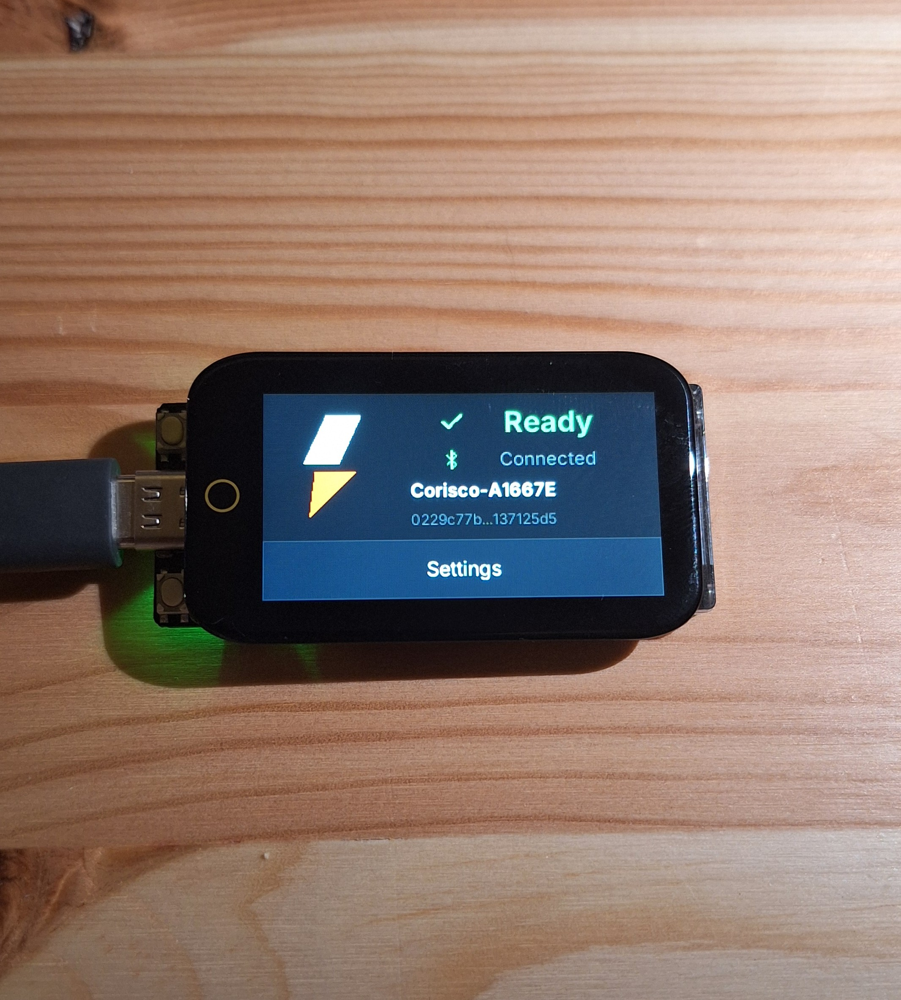
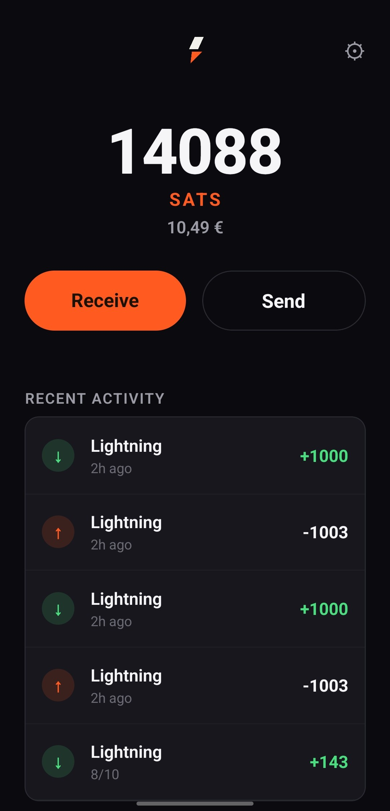

# Corisco

<p align="center">
  
  &nbsp;&nbsp;
  
</p>

A self-custodial Lightning wallet where private keys live on a dedicated
ESP32-S3 hardware device, not your phone. Every signature is confirmed
physically on the device's own screen before it happens.

Built on [Spark](https://www.spark.money/)'s FROST-based threshold
signing protocol.

## Try it in 10 minutes

You need:

- A [LilyGo T-Display-S3](https://github.com/Xinyuan-LilyGO/T-Display-S3) and a USB data cable
- An Android phone with Bluetooth (soon available for IOS)
- A computer (Windows, macOS or Linux) with [Rust](https://rustup.rs) installed, used only to flash

### 1. Install the app

1. On your phone, open the [latest app release](https://github.com/corisco-wallet/corisco-android-app/releases/latest).
2. Download `corisco-android-app-*.apk` and open it.
3. If Android asks, allow installs from your browser or file manager.

### 2. Flash the firmware

1. Download `esp32-lilygo-t-display-s3-firmware-*.bin` (the one **without** `-app`) from the
   [latest firmware release](https://github.com/corisco-wallet/corisco-firmware/releases/latest).
2. Install the flashing tool:

   ```bash
   cargo install espflash
   ```

3. Plug the T-Display-S3 into your computer and flash it:

   ```bash
   espflash write-bin 0x0 esp32-lilygo-t-display-s3-firmware-*.bin
   espflash reset
   ```

   On Linux, if you get a permission error: `sudo usermod -aG dialout $USER`, then log out and back in.

### 3. Set up the device

1. The device boots to the Welcome screen: create a new wallet and set a PIN.
2. **Write down your recovery words** and keep them offline.

### 4. Pair and use

1. Open the Corisco app, turn Bluetooth on and pick your device (it shows up as `Corisco-<id>`).
2. Receive a payment, or send one and **confirm it on the device's screen**. Nothing is signed until you do.

> Early software: test with small amounts only.
> Need a hand? [Open an issue](https://github.com/corisco-wallet/corisco-firmware/issues).

## Repositories

- **[corisco-firmware](https://github.com/corisco-wallet/corisco-firmware)** -- the
  ESP32 hardware-signer firmware and the BLE wire protocol it defines.
- **[corisco-android-app](https://github.com/corisco-wallet/corisco-android-app)** --
  the React Native mobile app, tested against the firmware's protocol
  vectors.
- **[crypto-core](https://github.com/corisco-wallet/crypto-core)** -- the
  platform-agnostic signing logic (BIP32/BIP39, FROST threshold signing,
  the leaf-ownership-transfer crypto) used by the firmware.

Start with `corisco-firmware`'s README for the architecture overview and a
quickstart for each component.

## Contributing and security

Contribution guides: [firmware](https://github.com/corisco-wallet/corisco-firmware/blob/main/CONTRIBUTING.md)
· [android app](https://github.com/corisco-wallet/corisco-android-app/blob/main/CONTRIBUTING.md)
· [crypto-core](https://github.com/corisco-wallet/crypto-core/blob/main/CONTRIBUTING.md).
Found a vulnerability? Report it privately, see the
[security policy](https://github.com/corisco-wallet/.github/blob/main/SECURITY.md).

## Support us

[](https://buymeacoffee.com/ruipedro07)
· [Other ways to donate (BTC)](https://github.com/corisco-wallet/.github/blob/main/DONATE.md)
